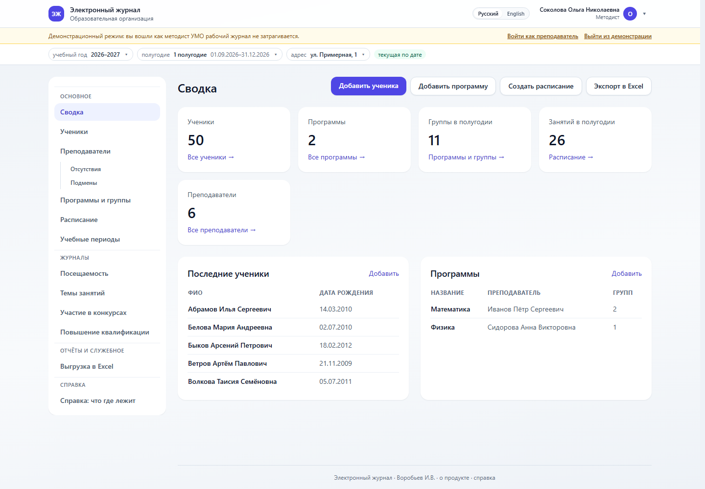
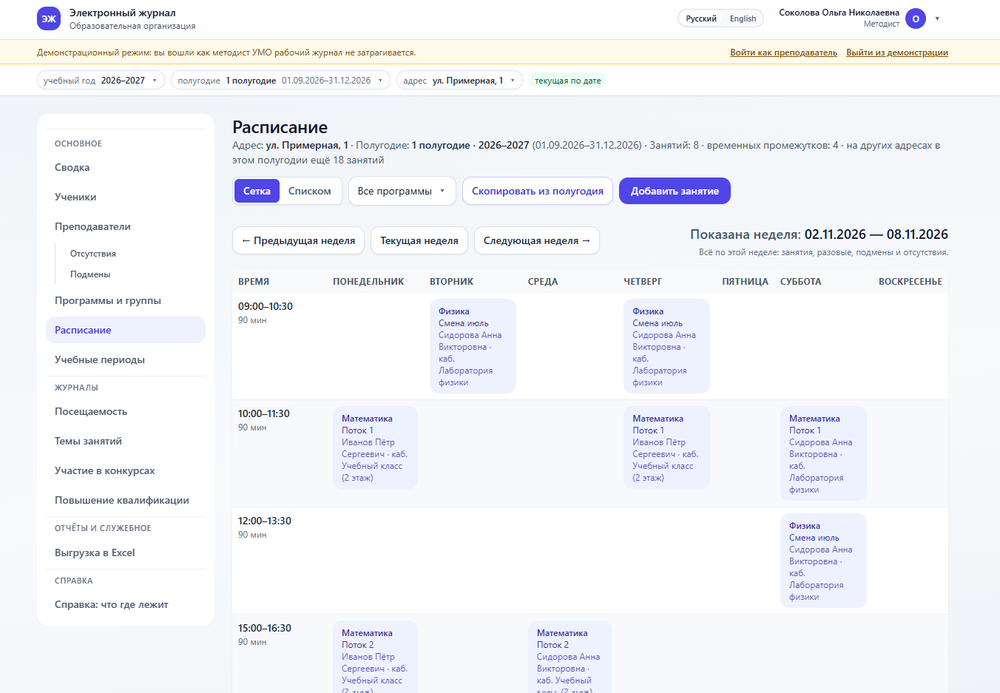
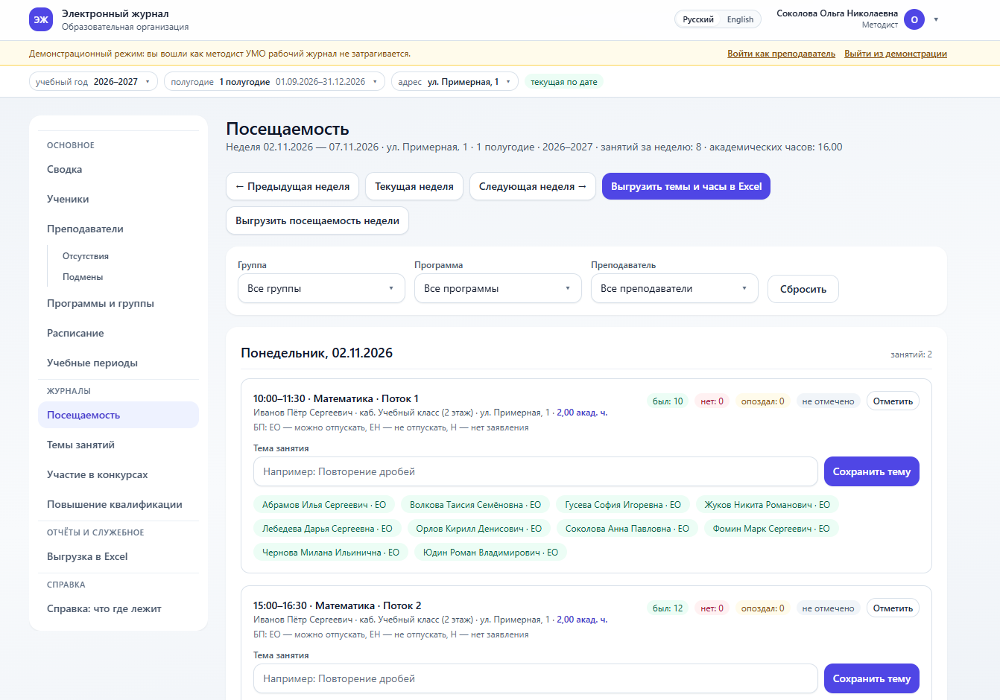

<p align="center"><b>English</b> &nbsp;·&nbsp; <a href="README.ru.md">Русский</a></p>

<p align="center">
  <picture>
    <source media="(prefers-color-scheme: dark)" srcset="docs/branding/logo-wordmark-light.png?v=2">
    
  </picture>
</p>

# Electronic attendance journal

A web attendance journal for an educational organisation: students, programmes, groups
with their membership, the schedule by branch and term, attendance marks, class topics
with academic hours, exports to Excel and as an image, backups.

Stack: **Django 5 + PostgreSQL 16 + Docker**, the interface is Django Templates and
Tailwind CSS (the styles are part of the project, no Node.js build needed). There are no
grades — attendance only: `P` — present, `A` — absent, `L` — late.

<p align="center">
  
  <br>
  <sub><b>Dashboard</b> · summary for the term</sub>
</p>

|  |  |
|:---:|:---:|
| <br><sub><b>Schedule</b> · the week grid</sub> | <br><sub><b>Attendance</b> · the weekly marks table</sub> |
<sub>The screenshots of the schedule and attendance show the Russian interface — the journal is fully bilingual.</sub>

## Features

* **Academic years and terms** with dates that can be changed; moving programmes, groups
  and the schedule from the previous term to the new one with a single command in the interface.
* **Branches (addresses) and rooms.** The schedule, programmes and marks belong to a branch;
  a teacher's time is shared across all branches, and room occupancy is checked.
* **Students** with patronymic and date of birth, a search by full name, importing a list from Excel.
* **Programmes and groups** with their membership, several teachers per programme, substitutions
  and teacher absences.
* **Schedule** as a grid and as a list, one-off classes, conflict checking.
* **Attendance** by week: `P`/`A`/`L` marks for every student, class topics and academic hours
  (1 academic hour = 45 minutes).
* **Exports:** Excel (attendance, topics, schedule, competitions, courses) and the schedule as a
  PNG image in portrait or landscape orientation.
* **Roles:** chief administrator, administrator, methodist (teaching and methodology support
  staff), teacher.
* **Security:** a log of sign-ins and events, allow and deny lists of IP addresses, protection
  against password guessing, automatic blocking of scanners, HTTPS settings.
* **Appearance:** several themes, your own logo and favicon, the name of the organisation.
* **Backups:** a single JSON file with all the data, encrypted if you wish.
* The interface is available in Russian and English.

## Requirements

* **Docker Engine 20.10+** and **Compose v2** (`docker compose`) — Docker Desktop
  on Windows and macOS or Docker Engine on a server. Python, PostgreSQL and the libraries
  do not have to be installed — they are inside the containers. If Docker is not installed,
  see the section [“If Docker is not installed”](#if-docker-is-not-installed).
* A free port **8000** (or another one — the `WEB_PORT` variable).
* Internet access during the first build: base images and Python packages are downloaded.

## One-command installation

**Linux and macOS:**

```bash
bash install.sh
```

**Windows** (PowerShell in the project folder):

```powershell
powershell -ExecutionPolicy Bypass -File .\install.ps1
```

The script does everything itself:

1. checks that Docker is installed and responding, and that `docker compose` is available;
2. creates `.env` from `.env.example` if the file does not exist yet: generates a random
   `SECRET_KEY` (64 characters) and `POSTGRES_PASSWORD` (40 characters), sets `DEBUG=0`
   and `ALLOWED_HOSTS=localhost,127.0.0.1`;
3. builds and starts the `db` and `web` containers (`docker compose up -d --build`);
4. waits until it is ready: polls `python manage.py healthcheck` inside the container
   (up to 5 minutes) and shows the logs if the journal did not come up;
5. prints the journal address and what to do on the first opening.

After installation the journal opens at **http://localhost:8000**.
The port can be changed in `.env`: `WEB_PORT=8080` → `http://localhost:8080`.

> **Re-running is safe.** If `.env` already exists, the script leaves it alone:
> the secrets and settings stay as they were, and the data in the `postgres_data` and
> `media_data` volumes is kept. The same script is used to update to a new version.

Installer flags (Linux only, details in the section
[“If Docker is not installed”](#if-docker-is-not-installed)):

```bash
bash install.sh --install-docker   # agree to install Docker without asking
bash install.sh --no-prompt        # no questions: instructions only
```

### Manual installation (without the script)

```bash
cp .env.example .env
# open .env and fill in SECRET_KEY and POSTGRES_PASSWORD
docker compose up -d --build
docker compose exec -T web python manage.py healthcheck   # wait until it reports 0 errors
```

`SECRET_KEY` is a random string of at least 50 characters, `POSTGRES_PASSWORD` is the
database password. Generate them:

```bash
openssl rand -base64 64 | LC_ALL=C tr -dc 'A-Za-z0-9' | cut -c1-64   # SECRET_KEY
openssl rand -hex 24                                                 # POSTGRES_PASSWORD
```

## If Docker is not installed

The journal runs in containers, so it will not start without Docker. On launch
`install.sh` checks `docker` and `docker compose` and, if something is missing, explains
the situation and offers a solution.

### Linux

The script reads `/etc/os-release`, shows what it detected and asks:

```
System: Ubuntu 24.04.1 LTS (ubuntu, noble 24.04)
Installing Docker with the official get.docker.com script.

Install Docker now? [y/N]
```

* **The default answer is no.** Enter or `n` cancels the installation: the script prints
  the commands for a manual installation and exits with code 1, changing nothing on the machine.
* **The answer `y`** (or `yes`) — the script downloads the official `get.docker.com`
  installer, runs it (through `sudo` if you are not root), then runs
  `sudo usermod -aG docker "$USER"`. Every command it executes is printed, and the output
  of the installer is visible in full. At the end there is an honest warning: you have to
  **log in again** or run `newgrp docker` (otherwise `docker` will not let you in without
  `sudo`), and then run `bash install.sh` again.
* **No terminal** (run from a script, CI, cron) — the question is not asked: instructions
  straight away and exit code 1. For an automatic installation there is the flag
  `--install-docker`, and `--no-prompt` disables any questions and leaves only the instructions.

**Which systems the installer sets up automatically** (according to `/etc/os-release`):

| System | Automatic installation |

| --- | --- |

| Ubuntu 22.04 LTS, 24.04 LTS | yes |

| Ubuntu derivatives: Linux Mint, Pop!_OS and similar (`ID_LIKE=ubuntu`) | yes, if the base is 22.04 or 24.04 |

| Debian 11, 12 | yes |

| Fedora, RHEL, AlmaLinux, Rocky Linux 9 and newer | yes |

| Arch Linux, openSUSE, Alpine and others | no: the script does not install Docker, it shows the command for your package manager and a link to the official instructions, exit code 1 |

| An unknown distribution or an empty version | no, for the same reason |

Checking the version is mandatory: installing Docker “at random” on an unfamiliar system
is risky, so it is better to show the person the exact command.

### macOS and Windows

Docker Desktop here is installed **by hand only**: it is a large application with a
graphical setup wizard, it has to be started after installation (and sometimes the system
has to be rebooted), and the Docker Desktop licence for large organisations is paid.
The decision to install must stay with a human, so `install.sh` and `install.ps1` download
and install nothing, ask no questions and offer no installation flags — they only show
what is missing and give the links:

* Docker Desktop: <https://www.docker.com/products/docker-desktop/>
* installing on macOS: <https://docs.docker.com/desktop/install/mac-install/>
* installing on Windows: <https://docs.docker.com/desktop/install/windows-install/>

After installation start Docker Desktop, wait for “Engine running” and run the journal
installation again.

### Other distributions manually

```bash
# Debian/Ubuntu
sudo apt-get install -y docker.io docker-compose-plugin

# Fedora/RHEL
sudo dnf install -y docker docker-compose-plugin

# Arch
sudo pacman -S docker docker-compose
```

Official instructions: <https://docs.docker.com/engine/install/>

### If Docker is already there

The journal itself only needs **Docker Engine 20.10+** and **Compose v2**
(`docker compose`), and how they were installed does not matter: Docker Desktop, a package
from the distribution repository, snap or a corporate build. If the `docker` and
`docker compose` commands work, `install.sh` goes straight to installing the journal.

## First launch

While there is no active administrator in the database, the journal opens the initial setup
wizard by itself — `/setup/`.

1. Create the chief administrator: **login** (Latin letters, digits and the characters
   `@ . + - _`), **surname**, **name**, optionally the patronymic and an email address,
   **password** and its confirmation.
2. Set the appearance: the journal name, the organisation name, a short sign (1–4 letters),
   optionally a logo and a favicon (PNG, JPG, WEBP or ICO, up to 1 MB).
3. Press the save button — the journal creates an account with the role
   “Chief administrator”, signs you in immediately and opens the dashboard.

The wizard appears once. After that you sign in on the page `http://localhost:8000/login/`.
The other staff members are created inside the journal: **“Teachers”** (the role
“Teacher”) and **“Teaching and methodology support staff”** (methodist or administrator).
The password is shown once when the account is created, and it can be generated with a button.

If an administrator has to be created from the console:

```bash
docker compose exec web python manage.py createsuperuser
```

## Demo mode

Demo mode shows the journal without a password and without risk to the working data: it runs
on a separate demo database, and the changes in it are not saved.

1. In `.env` set `DEMO_MODE=1`.
2. Restart the journal:

```bash
docker compose up -d
```

3. Open `http://localhost:8000/demo/` and press **“Sign in as the methodist”** or
   **“Sign in as the teacher”**.

The demo database already has ready-made data: students, staff, several branches with rooms,
a filled-in schedule with substitutions and one-off classes, marks for the last month, class
topics, competitions and courses. The demo session lives until the browser is closed.

Before real work set `DEMO_MODE=0` back and restart the journal.
More details are in [docs/admin-guide.md](docs/admin-guide.md), section 12.

## Main sections of the journal

| Section | What is there |

| --- | --- |

| **Dashboard** | counters (students, programmes, groups, teachers), the nearest classes, quick links |

| **Students** | a list with a search by full name, student cards, import from Excel |

| **Programmes and groups** | the programmes of the active term and the branches, groups, group membership |

| **Schedule** | classes by branch: a grid and a list, rooms, substitutions, one-off classes |

| **Attendance** | the weekly journal: dates, topics, academic hours, `P`/`A`/`L` marks |

| **Class topics** | what the teachers filled in, filters and an export |

| **Academic periods** | years and terms, dates, counters, moving from another term |

| **Teachers** | accounts, changing the password, absences |

| **Absences and substitutions** | absence periods and replacements for all classes of a period |

| **Competitions** | students taking part in competitions and olympiads |

| **Professional development** | courses of the teachers |

| **Export to Excel** | tables and the schedule as a PNG image |

| **Teaching and methodology support staff** | methodists and administrators (administrator only) |

| **Security** | email and notifications, access by IP, the sign-in log |

| **Backup** | download and restore the data |

| **Demo mode and demo data** | the state of the demo database and clearing it |

| **Customisation** | themes and appearance (chief administrator only) |

| **Django admin** | the standard admin, the address is set by `ADMIN_URL` |

A teacher sees only their own classes, their own weeks and a personal export; the other
sections are not available to them. The full description of the permissions is in
[docs/admin-guide.md](docs/admin-guide.md).

## Backups

The **“Backup”** section (`/backup/`, administrators only):

* **Download a copy** — a single JSON file with all the journal data. With a passphrase
  the file is downloaded encrypted (`.json.enc`).
* **Restore** — from a `.json` or `.json.enc` file, in the “Add and update” mode
  (deletes nothing) or “Replace completely” (with confirmation).

What matters:

* the copy contains **password hashes** and personal data — do not send the file by email
  and do not put it into shared folders; the journal does not store the passphrase;
* the logo and the favicon are not part of the copy: they live in the `media_data` volume;
* the journal database lives in the `postgres_data` volume and is kept through updates and
  shutdowns.

## Updating

1. Download a backup (the “Backup” section).
2. Replace the project files with the new version, **except `.env`** (your settings and
   secrets are carried over as they are).
3. Build and start:

```bash
docker compose up -d --build
```

Database migrations are applied automatically when the `web` container starts. Check the journal:

```bash
docker compose exec web python manage.py healthcheck
```

At the end there must be 11 checks and 0 errors. After updating press **Ctrl+F5** in the
browser so that it downloads the styles and scripts again.

> `docker compose down` stops the journal, the data is kept.
> `docker compose down -v` **deletes the database volume** — use it only if you really want
> to start with an empty journal.

## Settings

All settings are in the `.env` file in the project root. The full list with explanations is
in [.env.example](.env.example). The most important ones:

| Variable | Default | Why |

| --- | --- | --- |

| `SECRET_KEY` | — (required) | the signing key for sessions and CSRF, at least 50 characters |

| `POSTGRES_PASSWORD` | — (required) | the database password |

| `DEBUG` | `0` | `1` — detailed errors, for local debugging only |

| `ALLOWED_HOSTS` | `localhost,127.0.0.1` | the domains the journal is opened by |

| `DEMO_MODE` | `0` | `1` — demo mode |

| `DJANGO_LANGUAGE_CODE` | `ru` | the default interface language (`ru` or `en`) |

| `TIME_ZONE` | `Europe/Moscow` | the time zone of the journal |

| `WEB_PORT` | `8000` | the port on the machine the journal is opened by |

| `FUND_NAME` | from `settings.py` | the organisation name on the sign-in page and in the footer |

| `ADMIN_URL` | `admin/` | the address of the Django admin |

For working over HTTPS there are `TRUST_PROXY_HEADERS`, `SECURE_SSL_REDIRECT`,
`SESSION_COOKIE_SECURE`, `CSRF_COOKIE_SECURE`, `SECURE_HSTS_SECONDS` — they are off by
default so that the journal works over `http://localhost`. The publishing procedure is
described in [docs/admin-guide.md](docs/admin-guide.md), section 11.

## Documentation

* [docs/admin-guide.md](docs/admin-guide.md) — the administrator guide: installation,
  first launch, updating, backups, roles, the workflow of the methodist, exports, security
  and what to do if something went wrong.
* [docs/NEXT-STEPS.md](docs/NEXT-STEPS.md) — the state of the project and open tasks
  (for the developer).
* [CHANGELOG.md](CHANGELOG.md) — the version history.
* Inside the journal: the **“About the product”** page (`/about/`) and the help page
  **“Help: what is where”** (`/faq/`) — available without signing in.

## Project structure

```
.
├── docker-compose.yml        the db (PostgreSQL) and web (gunicorn) services
├── Dockerfile                the application image
├── entrypoint.sh             migrations, the demo database, static files, starting gunicorn
├── install.sh                installation and updating (Linux, macOS)
├── install.ps1               installation and updating (Windows)
├── .env.example              the settings template, all variables with explanations
├── manage.py
├── school_journal/           settings, routes, wsgi
├── journal/                  the application: models, forms, views, templates, static files
│   ├── tests/                automated tests
│   └── management/commands/  demo_setup, healthcheck, clear_demo, build_locales
├── docs/                     documentation
└── locale/                   interface translations
```

## If something went wrong

**The build fails with `python:3.12-slim: TLS handshake timeout`.** Docker cannot download
the image from Docker Hub. Specify a mirror in `.env`:

```dotenv
PYTHON_IMAGE=dockerhub.timeweb.cloud/library/python:3.12-slim
POSTGRES_IMAGE=dockerhub.timeweb.cloud/library/postgres:16-alpine
```

and run the installation again. Other mirrors: `mirror.gcr.io/library/...`,
`public.ecr.aws/docker/library/...`.

**Port 8000 is taken.** Set `WEB_PORT=8080` in `.env` and restart
(`docker compose up -d`); the journal will be at `http://localhost:8080`.

**The journal reports that `SECRET_KEY` or `ALLOWED_HOSTS` is not set.** There are empty
required variables in `.env`. The easiest way is to delete `.env` and run `install.sh` again —
it will create the file with random secrets. Or fill in the values by hand (the hints are in
`.env.example`).

**The journal does not answer after installation.** Look at the logs:

```bash
docker compose ps
docker compose logs --tail=100 web
docker compose exec web python manage.py healthcheck
```

**The styles are not applied after an update.** Press **Ctrl+F5** — the browser will take
the new files instead of the cache.

## Publishing to the internet

The journal can be opened to the outside, but by default it is configured for a local run.
Before publishing: set `DEBUG=0` (it already is), add your domain to `ALLOWED_HOSTS`,
enable the HTTPS flags, when working behind nginx — `TRUST_PROXY_HEADERS=1`, if you wish,
close the admin with a non-standard `ADMIN_URL` and enable blocking of scanning addresses.
Step by step — [docs/admin-guide.md](docs/admin-guide.md), section 11; a ready-made example
for fail2ban — [docs/fail2ban-journal.conf](docs/fail2ban-journal.conf).

## Licence

The project is distributed under the **MIT** licence. The full text of the licence is in
the [LICENSE](LICENSE) file in the repository root.

Copyright (c) 2026 Vorobyov I.V.

## Author

Vorobyov I.V.

---

## Built with

Developed with **DeepSeek Harness**.
