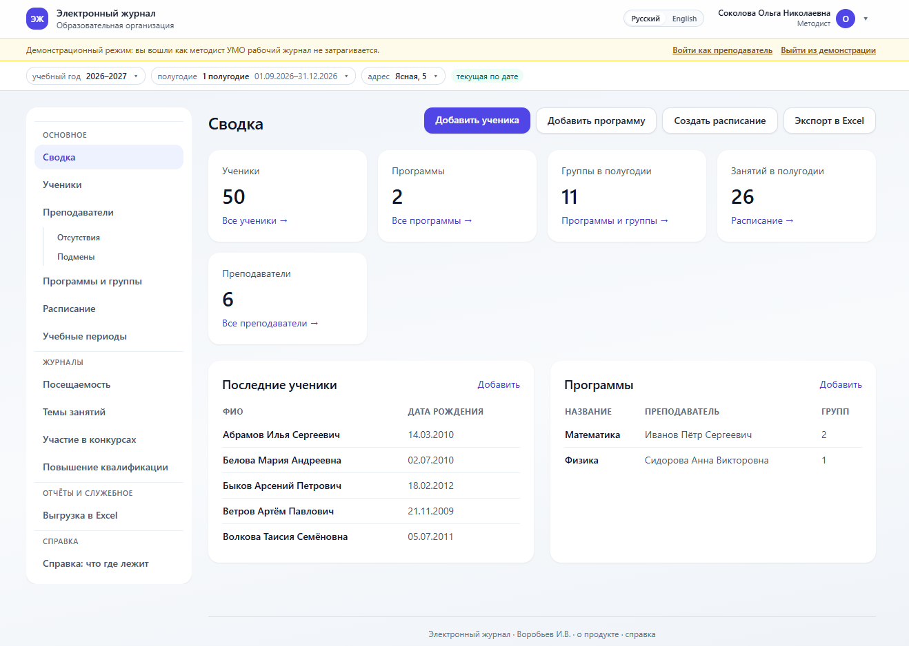
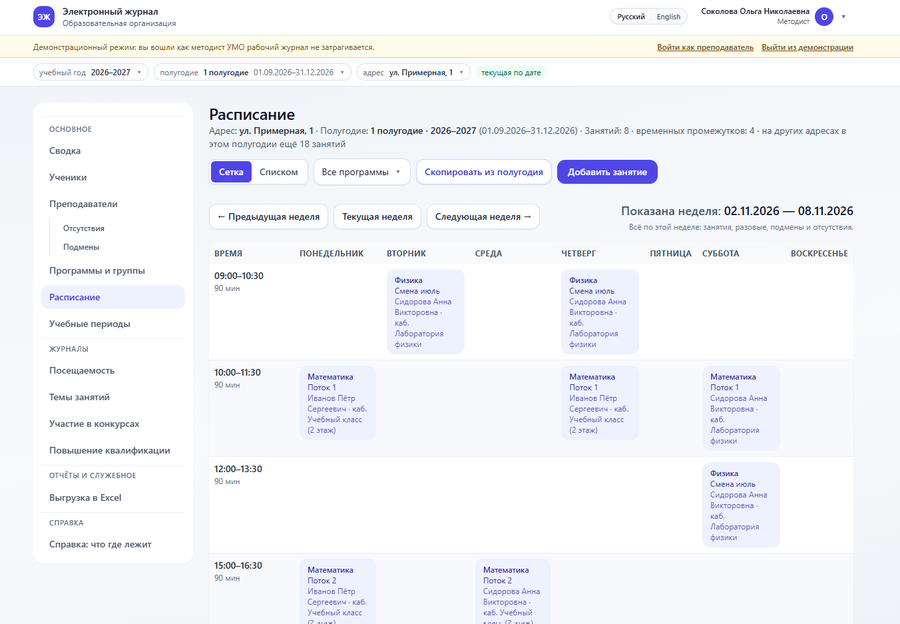
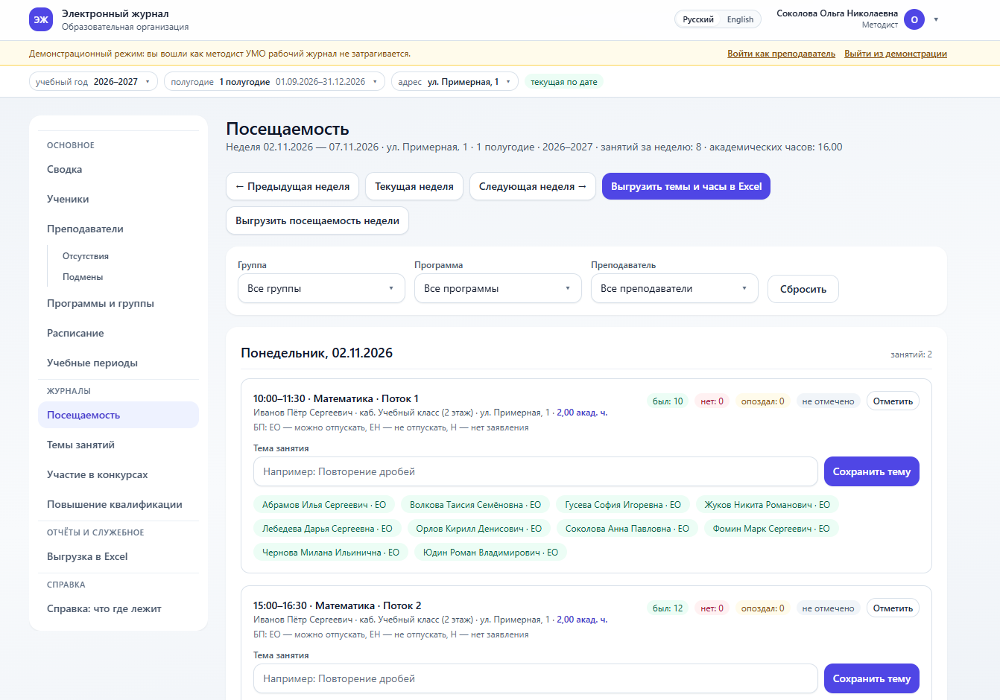

<p align="center"><a href="README.md">English</a> &nbsp;·&nbsp; <b>Русский</b></p>

# Электронный журнал посещаемости

Веб-журнал посещаемости для образовательной организации: ученики, программы, группы
с составом, расписание по адресам и полугодиям, отметки посещаемости, темы занятий
с академическими часами, выгрузки в Excel и картинкой, резервные копии.

Стек: **Django 5 + PostgreSQL 16 + Docker**, интерфейс — Django Templates и Tailwind CSS
(стили лежат в проекте, сборка Node.js не нужна). Оценок нет — только посещаемость:
`P` — присутствовал, `A` — отсутствовал, `L` — опоздал.

<p align="center">
  
  <br>
  <sub><b>Главная</b> · сводка за полугодие</sub>
</p>

|  |  |
|:---:|:---:|
| <br><sub><b>Расписание</b> · сетка по дням</sub> | <br><sub><b>Посещаемость</b> · недельная таблица отметок</sub> |

## Возможности

* **Учебные годы и полугодия** с датами, которые можно менять; перенос программ, групп
  и расписания из прошлого полугодия в новое одной командой в интерфейсе.
* **Адреса (филиалы) и кабинеты.** Расписание, программы и отметки относятся к адресу;
  время преподавателя общее для всех адресов, занятость кабинетов проверяется.
* **Ученики** с отчеством и датой рождения, поиск по ФИО, импорт списка из Excel.
* **Программы и группы** с составом, несколько преподавателей у программы, подмены
  и отсутствия преподавателей.
* **Расписание** в виде сетки и списком, разовые занятия, проверка конфликтов.
* **Посещаемость** по неделям: отметки `P`/`A`/`L` по каждому ученику, темы занятий
  и академические часы (1 академический час = 45 минут).
* **Выгрузки:** Excel (посещаемость, темы, расписание, конкурсы, курсы) и расписание
  картинкой PNG в вертикальной или горизонтальной ориентации.
* **Роли:** главный администратор, администратор, методист (сотрудник УМО), преподаватель.
* **Безопасность:** журнал заходов и событий, белые и чёрные списки IP, защита от подбора
  пароля, авто-блокировка сканеров, настройки HTTPS.
* **Оформление:** несколько тем, свой логотип и значок, название организации.
* **Резервные копии:** один файл JSON со всеми данными, по желанию зашифрованный.
* Интерфейс на русском и английском языках.

## Требования

* **Docker Engine 20.10+** и **Compose v2** (`docker compose`) — Docker Desktop
  на Windows и macOS или Docker Engine на сервере. Python, PostgreSQL и библиотеки
  ставить не нужно — они внутри контейнеров. Если Docker не установлен, см. раздел
  [«Если Docker не установлен»](#если-docker-не-установлен).
* Свободный порт **8000** (или другой — переменная `WEB_PORT`).
* Интернет при первой сборке: скачиваются базовые образы и пакеты Python.

## Установка одной командой

**Linux и macOS:**

```bash
bash install.sh
```

**Windows** (PowerShell в папке проекта):

```powershell
powershell -ExecutionPolicy Bypass -File .\install.ps1
```

Скрипт делает всё сам:

1. проверяет, что Docker установлен и отвечает, и что есть `docker compose`;
2. создаёт `.env` из `.env.example`, если файла ещё нет: генерирует случайные
   `SECRET_KEY` (64 символа) и `POSTGRES_PASSWORD` (40 символов), ставит `DEBUG=0`
   и `ALLOWED_HOSTS=localhost,127.0.0.1`;
3. собирает и запускает контейнеры `db` и `web` (`docker compose up -d --build`);
4. ждёт готовности: опрашивает `python manage.py healthcheck` внутри контейнера
   (до 5 минут) и показывает логи, если журнал не поднялся;
5. печатает адрес журнала и что делать при первом открытии.

После установки журнал открывается по адресу **http://localhost:8000**.
Порт можно поменять в `.env`: `WEB_PORT=8080` → `http://localhost:8080`.

> **Повторный запуск безопасен.** Если `.env` уже есть, скрипт его не трогает:
> секреты и настройки остаются прежними, данные в томах `postgres_data` и `media_data`
> сохраняются. Этот же скрипт используется для обновления версии.

Флаги установщика (только Linux, подробности — в разделе
[«Если Docker не установлен»](#если-docker-не-установлен)):

```bash
bash install.sh --install-docker   # согласие на установку Docker без вопроса
bash install.sh --no-prompt        # без вопросов: только инструкции
```

### Установка вручную (без скрипта)

```bash
cp .env.example .env
# откройте .env и заполните SECRET_KEY и POSTGRES_PASSWORD
docker compose up -d --build
docker compose exec -T web python manage.py healthcheck   # ждём «errors: 0»
```

`SECRET_KEY` — случайная строка не короче 50 символов, `POSTGRES_PASSWORD` — пароль
базы. Сгенерировать:

```bash
openssl rand -base64 64 | LC_ALL=C tr -dc 'A-Za-z0-9' | cut -c1-64   # SECRET_KEY
openssl rand -hex 24                                                 # POSTGRES_PASSWORD
```

## Если Docker не установлен

Журнал работает в контейнерах, поэтому без Docker он не запустится. При запуске
`install.sh` проверяет `docker` и `docker compose` и, если чего-то нет, объясняет
ситуацию и предлагает решение.

### Linux

Скрипт читает `/etc/os-release`, показывает, что определил, и спрашивает
(вывод установщика — на английском):

```
System: Ubuntu 24.04.1 LTS (ubuntu, noble 24.04)
Installing Docker with the official get.docker.com script.

Install Docker now? [y/N]
```

* **Ответ по умолчанию — нет.** Enter или `n` отменяет установку: скрипт печатает
  команды для ручной установки и выходит с кодом 1, ничего не меняя на машине.
* **Ответ `y`** (или `yes`) — скрипт скачивает официальный установщик
  `get.docker.com`, запускает его (через `sudo`, если вы не root), затем выполняет
  `sudo usermod -aG docker "$USER"`. Все выполняемые команды печатаются, вывод
  установщика виден целиком. В конце — честное предупреждение: нужно **перелогиниться**
  или выполнить `newgrp docker` (иначе `docker` не пустит без `sudo`), после чего
  запустить `bash install.sh` снова.
* **Нет терминала** (запуск из скрипта, CI, cron) — вопрос не задаётся: сразу
  инструкции и код возврата 1. Для автоматической установки есть флаг
  `--install-docker`, а `--no-prompt` отключает любые вопросы и оставляет только
  инструкции.

**Какие системы установщик ставит автоматически** (по данным `/etc/os-release`):

| Система | Автоматическая установка |
| --- | --- |
| Ubuntu 22.04 LTS, 24.04 LTS | да |
| Производные Ubuntu: Linux Mint, Pop!_OS и подобные (`ID_LIKE=ubuntu`) | да, если база — 22.04 или 24.04 |
| Debian 11, 12 | да |
| Fedora, RHEL, AlmaLinux, Rocky Linux 9 и новее | да |
| Arch Linux, openSUSE, Alpine и прочие | нет: скрипт не ставит Docker, а показывает команду для вашего пакетного менеджера и ссылку на официальную инструкцию, код возврата 1 |
| Неизвестный дистрибутив или пустая версия | нет, по той же причине |

Проверка версии обязательна: ставить Docker «наугад» на незнакомую систему
рискованно, поэтому лучше показать человеку точную команду.

### macOS и Windows

Docker Desktop здесь устанавливается **только вручную**: это большое приложение
с графическим мастером настройки, после установки его нужно запустить (а иногда
и перезагрузить систему), а лицензия Docker Desktop для крупных организаций
платная. Решение об установке должно остаться за человеком, поэтому `install.sh`
и `install.ps1` ничего не скачивают и не устанавливают, не задают вопросов и не
предлагают флагов установки — они только показывают, чего не хватает, и дают ссылки:

* Docker Desktop: <https://www.docker.com/products/docker-desktop/>
* установка на macOS: <https://docs.docker.com/desktop/install/mac-install/>
* установка на Windows: <https://docs.docker.com/desktop/install/windows-install/>

После установки запустите Docker Desktop, дождитесь «Engine running» и повторите
установку журнала.

### Другие дистрибутивы вручную

```bash
# Debian/Ubuntu
sudo apt-get install -y docker.io docker-compose-plugin

# Fedora/RHEL
sudo dnf install -y docker docker-compose-plugin

# Arch
sudo pacman -S docker docker-compose
```

Официальные инструкции: <https://docs.docker.com/engine/install/>

### Если Docker уже есть

Самому журналу нужен только **Docker Engine 20.10+** и **Compose v2**
(`docker compose`), а каким способом они поставлены — неважно: Docker Desktop,
пакет из репозитория дистрибутива, snap или корпоративная сборка. Если команды
`docker` и `docker compose` работают, `install.sh` сразу переходит к установке журнала.

## Первый запуск

Пока в базе нет ни одного активного администратора, журнал сам открывает мастер
первичной настройки — `/setup/`.

1. Создайте главного администратора: **логин** (латиница, цифры и символы `@ . + - _`),
   **фамилия**, **имя**, при желании отчество и почту, **пароль** и его повтор.
2. Задайте оформление: название журнала, название организации, короткий знак (1–4 буквы),
   при желании логотип и значок (PNG, JPG, WEBP или ICO, до 1 МБ).
3. Нажмите кнопку сохранения — журнал создаст учётную запись с ролью
   «Главный администратор», сразу выполнит вход и откроет сводку.

Мастер появляется один раз. Дальше вход — на странице `http://localhost:8000/login/`.
Остальные сотрудники заводятся в самом журнале: **«Преподаватели»** (роль
«Преподаватель») и **«Сотрудники УМО»** (методист или администратор). Пароль
показывается один раз при создании, его можно сгенерировать кнопкой.

Если администратора нужно создать из консоли:

```bash
docker compose exec web python manage.py createsuperuser
```

## Демо-режим

Демо-режим показывает журнал без пароля и без риска для рабочих данных: он работает
на отдельной демонстрационной базе, а изменения в ней не сохраняются.

1. В `.env` поставьте `DEMO_MODE=1`.
2. Перезапустите журнал:

```bash
docker compose up -d
```

3. Откройте `http://localhost:8000/demo/` и нажмите **«Войти как методист»** или
   **«Войти как преподаватель»**.

В демо-базе уже есть готовые данные: ученики, сотрудники, несколько адресов
с кабинетами, заполненное расписание с подменами и разовыми занятиями, отметки
за последний месяц, темы занятий, конкурсы и курсы. Сессия демонстрации живёт
до закрытия браузера.

Перед реальной работой верните `DEMO_MODE=0` и перезапустите журнал.
Подробнее — в [docs/admin-guide.md](docs/admin-guide.md), раздел 12.

## Основные разделы журнала

| Раздел | Что там |
| --- | --- |
| **Сводка** | счётчики (ученики, программы, группы, преподаватели), ближайшие занятия, быстрые ссылки |
| **Ученики** | список с поиском по ФИО, карточки, импорт из Excel |
| **Программы и группы** | программы активного полугодия и адреса, группы, состав групп |
| **Расписание** | занятия по адресу: сетка и список, кабинеты, подмены, разовые занятия |
| **Посещаемость** | недельный журнал: даты, темы, академические часы, отметки `P`/`A`/`L` |
| **Темы занятий** | что заполнили преподаватели, фильтры и выгрузка |
| **Учебные периоды** | годы и полугодия, даты, счётчики, перенос из другого полугодия |
| **Преподаватели** | учётные записи, смена пароля, отсутствия |
| **Отсутствия и подмены** | периоды отсутствия и замены на все занятия периода |
| **Конкурсы** | участие учеников в конкурсах и олимпиадах |
| **Повышение квалификации** | курсы педагогов |
| **Выгрузка в Excel** | таблицы и расписание картинкой PNG |
| **Сотрудники УМО** | методисты и администраторы (только администратор) |
| **Безопасность** | почта и уведомления, доступ по IP, журнал заходов |
| **Резервная копия** | скачать и восстановить данные |
| **Демо-режим и демо-данные** | состояние демо-базы и её очистка |
| **Кастомизация** | темы и оформление (только главный администратор) |
| **Админка Django** | стандартная админка, адрес задаётся `ADMIN_URL` |

Преподаватель видит только свои занятия, свои недели и личную выгрузку; остальные
разделы ему недоступны. Полное описание прав — в [docs/admin-guide.md](docs/admin-guide.md).

## Резервные копии

Раздел **«Резервная копия»** (`/backup/`, только для администраторов):

* **Скачать копию** — один файл JSON со всеми данными журнала. С парольной фразой
  файл скачивается зашифрованным (`.json.enc`).
* **Восстановить** — из файла `.json` или `.json.enc`, в режиме «Добавить и обновить»
  (ничего не удаляет) или «Полностью заменить» (с подтверждением).

Что важно:

* в копии лежат **хеши паролей** и персональные данные — не пересылайте файл по почте
  и не выкладывайте в общие папки; парольную фразу журнал не хранит;
* логотип и значок в копию не входят: они лежат в томе `media_data`;
* база журнала живёт в томе `postgres_data` и сохраняется при обновлении и остановке.

## Обновление

1. Скачайте резервную копию (раздел «Резервная копия»).
2. Замените файлы проекта на новую версию, **кроме `.env`** (свои настройки и секреты
   переносятся как есть).
3. Соберите и запустите:

```bash
docker compose up -d --build
```

Миграции базы применяются автоматически при старте контейнера `web`. Проверьте журнал:

```bash
docker compose exec web python manage.py healthcheck
```

В конце должно быть «Checks: 11, errors: 0». После обновления нажмите в браузере
**Ctrl+F5**, чтобы он заново скачал стили и скрипты.

> `docker compose down` останавливает журнал, данные сохраняются.
> `docker compose down -v` **удаляет том с базой данных** — используйте, только если
> действительно хотите начать с пустого журнала.

## Настройки

Все настройки — в файле `.env` в корне проекта. Полный список с пояснениями —
в [.env.example](.env.example). Самое нужное:

| Переменная | По умолчанию | Зачем |
| --- | --- | --- |
| `SECRET_KEY` | — (обязательна) | ключ подписи сессий и CSRF, не короче 50 символов |
| `POSTGRES_PASSWORD` | — (обязательна) | пароль базы данных |
| `DEBUG` | `0` | `1` — подробные ошибки, только для локальной отладки |
| `ALLOWED_HOSTS` | `localhost,127.0.0.1` | домены, по которым открывается журнал |
| `DEMO_MODE` | `0` | `1` — демонстрационный режим |
| `DJANGO_LANGUAGE_CODE` | `ru` | язык интерфейса по умолчанию (`ru` или `en`) |
| `TIME_ZONE` | `Europe/Moscow` | часовой пояс журнала |
| `WEB_PORT` | `8000` | порт на машине, по которому открывается журнал |
| `FUND_NAME` | из `settings.py` | название организации на странице входа и в подвале |
| `ADMIN_URL` | `admin/` | адрес админки Django |

Для работы по HTTPS есть `TRUST_PROXY_HEADERS`, `SECURE_SSL_REDIRECT`,
`SESSION_COOKIE_SECURE`, `CSRF_COOKIE_SECURE`, `SECURE_HSTS_SECONDS` — они выключены
по умолчанию, чтобы журнал работал по `http://localhost`. Порядок публикации описан
в [docs/admin-guide.md](docs/admin-guide.md), раздел 11.

## Документация

* [docs/admin-guide.md](docs/admin-guide.md) — руководство администратора: установка,
  первый запуск, обновление, резервные копии, роли, рабочий процесс методиста,
  выгрузки, безопасность и что делать, если что-то пошло не так.
* [docs/NEXT-STEPS.md](docs/NEXT-STEPS.md) — состояние проекта и незакрытые задачи
  (для разработчика).
* [CHANGELOG.md](CHANGELOG.md) — история версий.
* В самом журнале: страница **«О продукте»** (`/about/`) и справка **«Что где лежит»**
  (`/faq/`) — доступны без входа.

## Структура проекта

```
.
├── docker-compose.yml        сервисы db (PostgreSQL) и web (gunicorn)
├── Dockerfile                образ приложения
├── entrypoint.sh             миграции, демо-база, статика, запуск gunicorn
├── install.sh                установка и обновление (Linux, macOS)
├── install.ps1               установка и обновление (Windows)
├── .env.example              шаблон настроек, все переменные с пояснениями
├── manage.py
├── school_journal/           настройки, маршруты, wsgi
├── journal/                  приложение: модели, формы, представления, шаблоны, статика
│   ├── tests/                автотесты
│   └── management/commands/  demo_setup, healthcheck, clear_demo, build_locales
├── docs/                     документация
└── locale/                   переводы интерфейса
```

## Если что-то пошло не так

**Сборка падает с `python:3.12-slim: TLS handshake timeout`.** Docker не может скачать
образ с Docker Hub. Укажите зеркало в `.env`:

```dotenv
PYTHON_IMAGE=dockerhub.timeweb.cloud/library/python:3.12-slim
POSTGRES_IMAGE=dockerhub.timeweb.cloud/library/postgres:16-alpine
```

и запустите установку снова. Другие зеркала: `mirror.gcr.io/library/...`,
`public.ecr.aws/docker/library/...`.

**Порт 8000 занят.** Поставьте в `.env` `WEB_PORT=8080` и перезапустите
(`docker compose up -d`); журнал будет на `http://localhost:8080`.

**`Не задан SECRET_KEY` или `Не задан ALLOWED_HOSTS`.** В `.env` пустые обязательные
переменные. Проще всего удалить `.env` и запустить `install.sh` заново — он создаст
файл со случайными секретами. Или заполните значения вручную (подсказки — в `.env.example`).

**Журнал не отвечает после установки.** Посмотрите логи:

```bash
docker compose ps
docker compose logs --tail=100 web
docker compose exec web python manage.py healthcheck
```

**Не применяются стили после обновления.** Нажмите **Ctrl+F5** — браузер возьмёт
новые файлы вместо кэша.

## Публикация в интернет

Журнал можно открыть наружу, но по умолчанию он настроен на локальный запуск.
Перед публикацией: поставьте `DEBUG=0` (это уже так), добавьте свой домен в
`ALLOWED_HOSTS`, включите HTTPS-флаги, при работе за nginx — `TRUST_PROXY_HEADERS=1`,
при желании закройте админку нестандартным `ADMIN_URL` и включите блокировку
сканирующих адресов. Пошагово — [docs/admin-guide.md](docs/admin-guide.md), раздел 11;
готовый пример для fail2ban — [docs/fail2ban-journal.conf](docs/fail2ban-journal.conf).

## Лицензия

Проект распространяется по лицензии **MIT**. Полный текст лицензии лежит в
файле [LICENSE](LICENSE) в корне репозитория.

Copyright (c) 2026 Воробьев И.В.

## Автор

Воробьев И.В.

---

## Как разработан

Разработан с использованием **DeepSeek Harness**.
